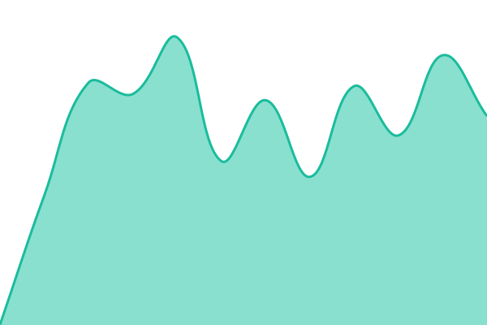

# [📈 Live Status](https://phnzzz.github.io/server-monitor): <!--live status--> **🟥 Complete outage**

This repository contains the open-source uptime monitor and status page for [phnzzz](https://phnzzz.github.io/server-monitor), powered by [Upptime](https://github.com/upptime/upptime).

With [Upptime](https://upptime.js.org), you can get your own unlimited and free uptime monitor and status page, powered entirely by a GitHub repository. We use [Issues](https://github.com/phnzzz/server-monitor/issues) as incident reports, [Actions](https://github.com/phnzzz/server-monitor/actions) as uptime monitors, and [Pages](https://phnzzz.github.io/server-monitor) for the status page.

<!--start: status pages-->
<!-- This summary is generated by Upptime (https://github.com/upptime/upptime) -->
<!-- Do not edit this manually, your changes will be overwritten -->
<!-- prettier-ignore -->
| URL | Status | History | Response Time | Uptime |
| --- | ------ | ------- | ------------- | ------ |
|  [WB Bidder](https://faithfully-settling-bird.cloudpub.ru/wb-bidder?cabinet=ooo) | 🟥 Down | [wb-bidder.yml](https://github.com/phnzzz/server-monitor/commits/HEAD/history/wb-bidder.yml) | 

 478ms
     
 | 

<a href="https://phnzzz.github.io/server-monitor/history/wb-bidder">68.15%</a>
    

<!--end: status pages-->

[**Visit our status website →**](https://phnzzz.github.io/server-monitor)

## 📄 License

- Powered by: [Upptime](https://github.com/upptime/upptime)
- Code: [MIT](./LICENSE) © [Anand Chowdhary](https://anandchowdhary.com)
- Data in the `./history` directory: [Open Database License](https://opendatacommons.org/licenses/odbl/1-0/)
